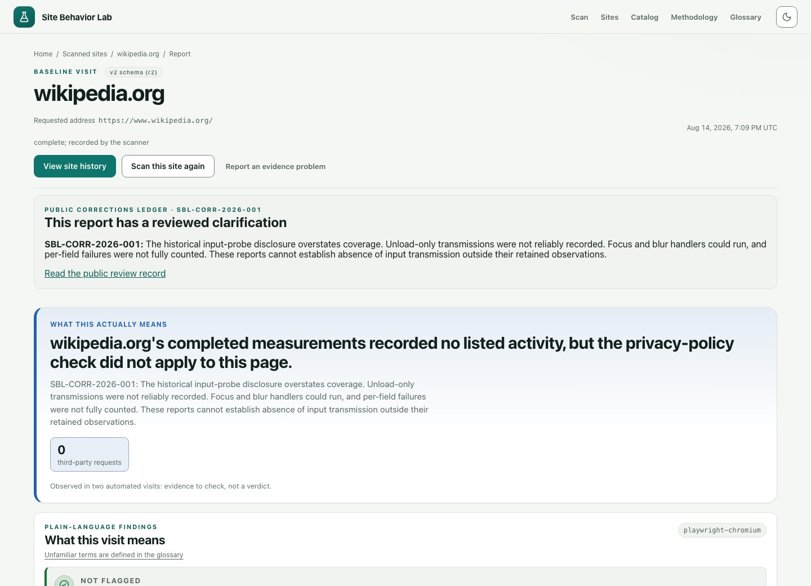

# Site Behavior Lab

[](https://github.com/iAnonymous3000/site-behavior-lab/actions/workflows/ci.yml?query=branch%3Amain)
[](LICENSE)

**Turn a website visit into evidence you can inspect.**

Site Behavior Lab visits a public website in headless Chromium and records its
requests, cookies, storage keys, browser signals, and consent behavior. Each
report ties plain-language findings to that evidence and keeps scan
conditions, missing coverage, and later corrections visible. A report
describes one measured visit, not a privacy score or a legal verdict.

[**Scan a website**](https://sitebehavior.org) ·
[Browse reports](https://sitebehavior.org/directory/) ·
[Read the methodology](https://sitebehavior.org/methodology/) ·
[See measurement limits](https://sitebehavior.org/catalog/)

[](https://sitebehavior.org/reports/20260814-31e105d7971825fbd0f3fffa099188fe/)

*The live report page, captured October 18, 2026. This historical GPC
comparison records August 14 visits and carries a reviewed clarification; it
does not describe Wikipedia's current behavior.*

| Start here | |
|---|---|
| **Understand a visit** | Follow findings into the request log, browser signals, and coverage details. Export JSON, an evidence bundle with CSV, or a printable PDF. |
| **Compare conditions** | Paired GPC, consent-choice, or Brave Shields simulation visits, with the intervention and visit order disclosed. |
| **Run your own instance** | [Local setup](#run-it-locally) · [Self-hosting](#self-host) |
| **Check or contribute** | [Verify a report](#verify-a-report) · [Contributing](CONTRIBUTING.md) · [Security](SECURITY.md) |

**Version:** `0.6.0` is the current release, tagged
[`v0.6.0`](https://github.com/iAnonymous3000/site-behavior-lab/tree/v0.6.0).
Product versions are independent of the report contracts: v1 is frozen, and
v2/r1 and v2/r2 are byte-immutable. See the [changelog](CHANGELOG.md) and
[release status](RELEASE.md#current-release-state).

## What it does

One scan is one automated visit from one place at one time. The scanner:

- loads the page through a per-scan proxy that pins every connection to a
  verified public IP address at connect time, so redirects and DNS rebinding
  cannot reach a private network;
- records requests (up to a cap), third-party domains, curated service and
  tracker labels, cookies (names and flags, never values), storage keys (never
  values), and the scan conditions (browser and Playwright versions, viewport,
  locale, timezone, Global Privacy Control state, egress, and catalog and
  methodology versions);
- observes high-entropy browser API use, fingerprinting heuristics, and
  third-party session-recording and input-monitoring listeners;
- types a synthetic, non-personal sentinel into up to eight supported fields
  in the viewport and watches whether it leaves the site, in plain, base64,
  hex, or hashed form. Submission is blocked, though focus, input, and blur
  callbacks can still send requests; unsupported, offscreen, and failed fields
  count as omitted coverage, and teardown-only sends are not measured. A visit
  where at least one field accepted the value discloses how many fields were
  typed into; a visit where no field accepted it carries no such statement;
- resolves first-party subdomains' CNAME chains to catch trackers hidden
  behind the site's own hostname;
- decodes the events Meta, TikTok, and X pixels fire and whether their
  advanced-matching fields were populated (checked in memory for being
  non-empty, never stored);
- detects consent tooling and, in consent comparison mode only, clicks one
  accept-all or reject-all control on the banner's first layer and reads back
  the registered consent state where the site exposes it;
- reads the site's privacy policy (HTML or a direct PDF, through the same
  network guard), quotes sentences the evidence contradicts, and lists
  observed tracking companies the policy does not appear to name;
- can pair two visits, in a random order it discloses: GPC off and on, a
  plain visit and a Brave Shields block simulation (Brave's ad-block engine
  over a pinned snapshot of its default lists, not a live Brave browser), or
  accept-all and reject-all consent.

Each report has a page (a plain-language headline over severity-ranked
findings), its JSON, a request CSV bundled with the source report and its
correction context, and a printable PDF. The public instance keeps reports for a
bounded window. A curated corpus of committed reports under `public/reports/`
drives the directory, per-site history, category pages, and the corpus
percentiles a report is ranked against. Each publication is appended to a
transparency log whose head is anchored with OpenTimestamps through a weekly
proposal that a maintainer merges.

## What a report proves, and what it does not

- **One visit, not the site.** A report is what one automated Chromium visit
  from the configured scanner saw. Sites vary by region, browser, IP
  reputation, login and consent state, bot detection, and time.
- **Counts describe the instrumented visit.** Request counts can be lower
  bounds when capture is incomplete; cookie and storage snapshots can change
  either way. None estimates an ordinary browser visit. Service Workers are blocked by design, a SharedWorker's traffic
  beyond its entry script and all WebSocket traffic go unrecorded, storage is
  read from the top frame only, the input probe does not scroll to offscreen
  fields, and the service catalog is a curated, US-biased list, not an
  inventory.
- **A failed or challenged load is not a clean result.** Sites that refuse
  undisguised automated browsers are reported as refusals, never evaded.
- **No detector accuracy is published.** No claim-bearing detector has an
  eligible calibration study yet, so there are no precision or recall
  figures. Findings are observations to verify.
- **Investigative evidence, not a verdict.** Findings require independent
  corroboration; standalone legal determinations and use as a sole court
  exhibit are excluded, as recorded in `RELEASE_READINESS.json`.
- **Attribution is not causation.** The script-to-request map records the
  initiator Chromium reported, which may itself have been told what to fetch.
- **Consent evidence spans the click.** Even a verified reject-all visit
  records traffic from before and after the choice, so a tracker seen there
  may be pre-choice, strictly necessary, or claimed under legitimate interest.
- **Percentiles need a cohort.** Corpus-relative severity applies only when
  the report's exact measurement cohort and the metric both hold at least 50
  sites; otherwise fixed thresholds apply and the report says so.

The per-detector coverage boundary is on the
[catalog page](https://sitebehavior.org/catalog/); each entry states
whether a test enforces it against the scanner source or it rests on review.

## Limits you should know before depending on it

Hard bounds in the Node scanner (`lib/scanner.ts`, `lib/scan-runtime.ts`,
`lib/public-scan-proxy.ts`, `lib/scan-limits.ts`):

| Bound | Value |
|---|---|
| Scan duration, per visit | 45 s (navigation 30 s) |
| Recorded requests, per visit | 1,000 |
| Proxy transactions / unique targets, per visit | 2,000 / 256 |
| Response bytes / upload bytes through the proxy, per visit | 64 MiB / 16 MiB |
| Concurrent scans per Node process, queued waiters, queue wait | 2, 8, 15 s |
| Async job queue (when enabled), all clients | 32 |
| Scan request body | 4 KiB |
| Report JSON reads, PDF renders, per client per minute | 120, 10 (one render slot) |
| Privacy-policy PDF | 8 MiB, 64 pages |
| Public instance, per client (edge quota) | 6 scans per minute, 120 per day; a comparison costs two |

**Off in the reference deployment.** Durable (restart-safe) jobs, container
sharding, and encrypted scheduled rescans are implemented behind flags
committed at `0`, and aggregate product metrics are off. A scan interrupted by
a container restart is lost and must be re-run.

**Road to 1.0.** The [investigative-v1 qualification contract](docs/v1-release-qualification.md)
requires independently checked scan outcomes bound to the release candidate,
plus provider, licensing, source, and release-authority evidence.
`npm run release:readiness` evaluates it; a green build or healthy deployment
is not qualification. There is no stable public API and no npm package.

**Retention.** The public instance keeps saved reports for seven days or 500
reports, whichever prunes first; operators may allow up to 936 reports, never
more than seven days. The committed corpus under `public/reports/` is the currently retained research corpus, with its own rules, and
reports cited by the corrections ledger are retention-pinned. Published reports
are never rewritten in place; corrections go through the append-only
`docs/corrections-ledger.md`, and a cited report is removed only when a privacy
replacement publishes a redacted copy under a new report ID.

**Network boundary.** The scanner refuses loopback, private, link-local,
carrier-grade NAT, multicast, and reserved addresses in both IP families,
allows standard ports only, and re-checks every address at connect time. On
the reference deployment that proxy is the only egress control; a
platform-level backstop is an open release gate (see `SECURITY.md`).

**Published data.** Cookie and storage values, credentials, URL fragments,
query values, and screenshots never enter a saved report. Query keys outside a
reviewed allow-list, path segments, subdomain labels, cookie names, storage
keys, and a hosting tenant name under a shared provider suffix (such as
`akamaihd.net`) shaped like an address, timestamp, or token are generalized. Policy quotes are a documented exception, capped in length, with
emails, handles, URLs, `www.` hosts, hosts with a path, and phone-shaped
numbers replaced by `[redacted]`; such a quote is marked incomplete and never
checked. The public-string policy in each r2 report's normalization identity
names these rules (currently `public-string-policy-v4`). A saved r2 report
holding a string a later rule removes is no longer served, and a committed
report is replaced for privacy; git history and earlier release archives keep the
original bytes.

## Run it locally

Use Node.js 24.14.1 with npm 11.11.0 (`.nvmrc`, `package.json`, and CI pin the
same versions).

```bash
npm ci
npx playwright install chromium
npm run dev
```

Open `http://127.0.0.1:3000`. Development needs no environment variables. A
local scan uses the production scanner, proxy, and limits, and by default
produces the legacy v1 report format; the public r2 format is a fail-closed
opt-in (below).

Anything that runs `next build` needs the public origin and refuses to guess
one:

```bash
NEXT_PUBLIC_SITE_BEHAVIOR_LAB_SITE_URL=https://example.org npm run check
```

`npm run check` runs the TypeScript and Cloudflare type checks, the unit suite,
and the production build. `npm run test:unit` recreates `.unit-test-dist/` on
every run, so never run two at once in one checkout. The static export and its
smoke test are `npm run build:pages` then `npm run test:smoke:static`.

## Self-host

The supported scanner is the Node/Playwright container built from the
`Dockerfile`; the legacy Browser Run worker was deleted rather than gated
because its DNS preflight could not pin the browser's eventual connection.

```bash
docker build \
  --build-arg SITE_BEHAVIOR_LAB_BUILD_COMMIT="$(git rev-parse HEAD)" \
  --build-arg NEXT_PUBLIC_SITE_BEHAVIOR_LAB_SITE_URL=https://scan.example.org \
  --build-arg NEXT_PUBLIC_SITE_BEHAVIOR_LAB_LIBRARY_ORIGIN=https://example.org \
  -t site-behavior-lab .
```

These build arguments are baked into the client bundle: the exact commit the
container reports in `/api/health`, the scanner's origin, and the origin of its
static site. The container runs as a non-root user, launches Chromium with an
explicit environment allow-list, and removes every package manager from the
runtime image.

| Variable | Default | What it decides |
|---|---|---|
| `SITE_BEHAVIOR_LAB_SCAN_ACCESS_TOKEN` | unset | When set, `/api/scan` requires it as `Authorization: Bearer`, `x-site-behavior-lab-access-token`, or the legacy `x-sbl-scan-token`. Leave it unset only for trusted local use or a deliberately open deployment with other abuse controls. |
| `SITE_BEHAVIOR_LAB_PUBLIC_R2_REPORTS` | unset | `1` returns and persists the public ScanReport v2/r2 format. It needs `SITE_BEHAVIOR_LAB_CONSENT_VERIFICATION=1`, a full 40-character `SITE_BEHAVIOR_LAB_BUILD_COMMIT`, and a report store, and refuses scans rather than fall back to v1. Unset, the scanner emits v1. |
| `SITE_BEHAVIOR_LAB_CONSENT_VERIFICATION` | unset | `1` reads back the registered consent state after a banner click (TCF and OneTrust) and attempts one disclosed post-choice reload. Required by r2. |
| `SITE_BEHAVIOR_LAB_REPORT_STORE_BACKEND` | `filesystem` | `filesystem` needs a persistent volume. `r2` needs `SITE_BEHAVIOR_LAB_R2_BUCKET`, `_ENDPOINT`, `_ACCESS_KEY_ID`, and `_SECRET_ACCESS_KEY`, and suits a public or multi-node deployment. |
| `SITE_BEHAVIOR_LAB_REPORT_MAX_AGE_DAYS` / `_MAX_COUNT` | `7` / `500` | Retention for saved shares (see Retention). |
| `SITE_BEHAVIOR_LAB_TRUST_PROXY_HEADERS` | unset | `1` only behind a proxy that controls forwarding headers and blocks direct origin access; rate limits then key on the rightmost `X-Forwarded-For` entry. |
| `SITE_BEHAVIOR_LAB_ALLOWED_ORIGIN` | `*` | CORS allow-list for the `/api` routes. |
| `SITE_BEHAVIOR_LAB_ASYNC_SCANS` | unset | `1` makes `/api/scan` answer `202` with a job to poll at `/api/scans/:id`; single process, in memory. |
| `SITE_BEHAVIOR_LAB_CHROMIUM_SANDBOX` | unset | `1` enables Chromium's sandbox, as production does; needs unprivileged user namespaces on the host. |
| `SITE_BEHAVIOR_LAB_SCANNER_EGRESS` / `_EGRESS_REGION` | `this scanner instance` / unset | The egress label and region recorded in reports. Declare a region only when it is true; without one, r2 comparison deltas are refused. |

The complete reference, including the Cloudflare-only quota, Turnstile,
durable-job, sharding, and watch settings, is `docs/configuration.md`, with
`.env.example` as a starting point. Runbooks:
`docs/deploy-cloudflare-containers.md` (Cloudflare Containers),
`docs/deploy-node-container.md` (a generic single node), and
`docs/deployment-topology.md` (the topology decision).

## The public deployment

[sitebehavior.org](https://sitebehavior.org) is a static Cloudflare Pages
export of this repository. [scan.sitebehavior.org](https://scan.sitebehavior.org)
runs the container scanner on Cloudflare Containers behind a front Worker that
enforces Turnstile and an atomic per-client quota, stores reports in R2, and
emits public r2. Both track the `production` branch, which CI fast-forwards to
the exact SHA it tested only after five gates pass: supply-chain security,
typecheck and unit tests and build, Chromium smoke, Docker runtime and public
R2 smoke, and exact-SHA evidence attestation. The production workflows deploy
the artifacts main CI built after verifying their exact-source attestations,
and each surface publishes the revision it serves at
[`/api/health`](https://scan.sitebehavior.org/api/health) and
[`/deployment.json`](https://sitebehavior.org/deployment.json).
Scanner non-production builds are disabled.
Pages automatic preview deployments are disabled, and existing preview deployments remain Access-protected.

Production health checks are scheduled four times an hour. The hourly production synthetic is active (a neutral scan, a public r2 result, a persisted
read-back, and a rendered report page), and the separate authenticated R2 delete canary is also active and required.
The WAF ceiling, log-retention, and independent egress backstop controls rest
on point-in-time operator receipts recorded in the runbook, not committed
evidence, so their release gates stay open until they are re-captured.

No scheduled workflow pushes to `main`. Featured-site rescans run weekly in two
legs (the gallery and the de-bias seed catalogs), each opening a pull request a
human must merge; the weekly transparency-log anchor extends one standing
anchor proposal a human must merge; Dependabot proposals get their derived
manifests regenerated and still need a human.

The weekly Brave Shields list refresh fetches and validates the lists, then
force-updates the proposal branch `automation/brave-list-refresh` and its pull
request. When upstream rules have moved, the snapshot is a new measurement
identity only a human can declare, by freezing the outgoing identity as a
closed producer row and adopting the `NODE_R2_CURRENT_ADBLOCK_IDENTITY`
literal that `npm run lists:adoption` prints; until then the proposal stays
open. Setting the `SITE_BEHAVIOR_LAB_MEASUREMENT_FREEZE` repository variable to
`1` quiesces the refresh. A separate job in the same workflow compares the
pinned adblock crate, Playwright, tldts, bundled Chromium, and the pdf.js and
undici versions the privacy-policy detector reads policy PDFs with against
their upstream stable releases and keeps the measurement-toolchain drift issue
open while an actionable upgrade is available.

## API

`POST /api/scan` takes a JSON body of `url`, `device` (`desktop` or `mobile`),
`gpcEnabled`, and at most one of `compareGpc`, `compareShields`,
`compareConsent`. A synchronous deployment answers with the report; an async
one answers `202` with `jobId` and `statusPath`, and `DELETE /api/scans/:id`
cancels cooperatively until publication begins. Refusals are `400` for an
invalid or non-public target, `401` for a missing token, `413` for an oversize
body, `429` for the per-client limit, and `503` when the scanner is busy, a
producer is misconfigured, or public-host verification could not complete.
`GET /api/reports/:id` returns the stored wire byte for byte, and
`GET /api/reports/:id/pdf` renders it. `GET /api/health` reports readiness,
the build commit, and the effective state of every producer flag.

## Verify a report

```bash
npm run verify:report -- <report-id>
```

That replays the digest chain from the committed report to the transparency
log; add `--from <dir>` to check bytes you saved yourself. Anchors cover a prefix of the log: entries published since the most recently anchored head
carry no anchor in the published log until an anchor proposal for a later head
is merged. Read `docs/verify-a-report.md` and `docs/evidence-custody.md` before
relying on a report; a printed copy is a rendering whose footer carries the
wire digest, not the evidence.

## Measurement identity

Every r2 report records the exact instrument it was measured with. The base
Node methodology is
`shields-request-context-v2-adblock-rust-0.13.3-request-method-v1-playwright-1.63.0+subject-validity-v4+detector-coverage-v2+fingerprint-surface-v2`,
and production r2 reports extend it with the phase-kernel, boundary-state,
consent, resource-budget, proxy-traffic, service-worker-block,
detector-accountability, service-role-taxonomy, GPC worker-application,
active-probe, auxiliary-context-block, and worker-fingerprint components,
recorded verbatim in `provenance.methodologyVersion`. Each detector's version
and the detector registry are recorded too. The Shields simulation uses the `adblock`
Rust crate compiled to WASM from `tools/adblock-wasm/` over a pinned snapshot
of Brave's default lists whose manifest digest is part of the identity; the
curated service catalog is `lib/tracker-catalog.ts`, versioned by digest.
Corpus statistics keep a separate cohort for every exact combination of
schema, methodology, catalog, taxonomy, metric contract, producer, and
requested GPC state, so a value is never compared across instruments. Changing
any of these is a measurement identity change and follows `RELEASE.md`, not a
routine edit.

## Where the details live

- `docs/runtime-boundaries.md`, `docs/scan-job-model.md`: what runs where,
  and the job lifecycle.
- `docs/scan-report-v2-rfc.md`, `docs/compatibility-promise.md`: the report
  contract and what may change in a committed report.
- `docs/limitations.md`: acceptable use, data attribution, and each
  measurement's limits in detail.
- `docs/research-evidence-model.md`, `docs/calibration-study-operations.md`,
  `docs/calibration-findings.md`: the evidence model and the calibration
  program that gates published detector accuracy.
- `docs/supply-chain-assurance.md`, `THIRD_PARTY_INVENTORY.json`,
  `THIRD_PARTY_REVIEWS.json`: dependency and filter-list provenance.
- `RELEASE.md`, `release-policy.json`, `RELEASE_READINESS.json`,
  `CHANGELOG.md`: what a tag claims and what still blocks 1.0.
- `docs/pagegraph-adapter.md`, `docs/native-shields-differential.md`:
  research-only importers and comparisons that never write public reports.
- `docs/audit-2026-10-17.md`: the most recent audit, with what changed, how
  it was verified, and what stays open; `docs/comprehensive-review-2026-09-22.md`
  and `docs/critical-use-audit-2026-09-01.md` came before it.

## Contributing, security, license

Read `CONTRIBUTING.md` before opening a change; the rule that matters most is
that a published claim never outruns the recorded evidence. Report
vulnerabilities through the private advisory channel described in
`SECURITY.md`, never in a public issue. The scanner is for inspecting publicly
reachable websites where that is allowed, not for attacking or probing systems
you do not own. The code is licensed under AGPL-3.0-or-later (`LICENSE`); the
curated catalog ships with it and bundles no third-party dataset.
