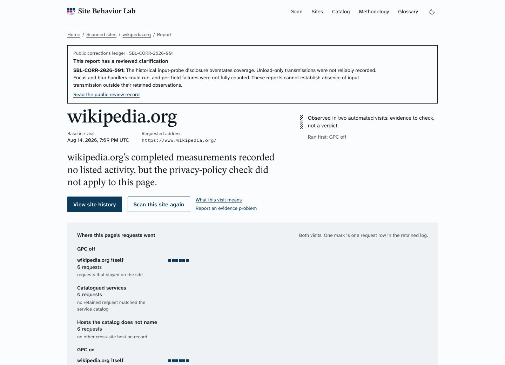

# Site Behavior Lab

[](https://github.com/iAnonymous3000/site-behavior-lab/actions/workflows/ci.yml?query=branch%3Amain)
[](LICENSE)

**Turn a website visit into evidence you can inspect.**

Site Behavior Lab visits a public website in headless Chromium and records its
requests, cookies, storage keys, browser signals, and consent behavior. Each
report ties plain-language findings to that evidence. It keeps the scan
conditions, missing coverage, and later corrections visible. A report
describes one measured visit, not a privacy score or a legal verdict.

[**Scan a website**](https://sitebehavior.org) ·
[Browse reports](https://sitebehavior.org/directory/) ·
[Read the methodology](https://sitebehavior.org/methodology/) ·
[See measurement limits](https://sitebehavior.org/catalog/)

[](https://sitebehavior.org/reports/20260814-31e105d7971825fbd0f3fffa099188fe/)

*The report page as built from the released commit `73c71cc6`, captured
November 16, 2026. This historical GPC comparison records August 14 visits
and carries a reviewed clarification; it does not describe Wikipedia's
current behavior.*

## What a report proves, and what it does not

- **One visit, not the site.** A report is what one automated Chromium visit
  from the configured scanner saw. Sites vary by region, browser, IP
  reputation, login and consent state, bot detection, and time.
- **Counts describe the instrumented visit.** Request counts can be lower
  bounds when capture is incomplete. Cookie and storage snapshots can change
  either way. None estimates an ordinary browser visit.
- **Some traffic and storage is not recorded.** Service Workers are blocked by
  design. A SharedWorker's traffic beyond its entry script and all WebSocket
  traffic go unrecorded. Storage keys are read from local and session storage
  in the top frame only; IndexedDB and Cache Storage are not read. The input
  probe does not scroll to offscreen fields. The service catalog is a curated,
  US-biased list, not an inventory.
- **A report's visit never scrolls.** An on-demand check after scrolling,
  opened from a fresh result, is a separate visit. It shows the third-party
  hosts its page first contacted after scrolling began, and the GA4 and Adobe
  Analytics events it saw sent, in its immediate result only, never in a
  report. It knows those events by their collection paths, so a renamed
  collection endpoint and Adobe's newer Web SDK go unread. It counts only
  requests that got an answer. Its list matches are computed while the page
  loads normally; they are not measured blocks.
- **A failed or challenged load is not a clean result.** Sites that refuse
  undisguised automated browsers are reported as refusals, never evaded.
- **No detector accuracy is published.** No claim-bearing detector has an
  eligible calibration study yet, so there are no precision or recall
  figures. Findings are observations to verify.
- **Investigative evidence, not a verdict.** Findings require independent
  corroboration. Standalone legal determinations and use as a sole court
  exhibit are excluded, as recorded in `RELEASE_READINESS.json`.
- **Attribution is not causation.** The script-to-request map records the
  initiator Chromium reported. That initiator may itself have been told what
  to fetch, may be a fetch or XHR wrapper credited with another script's
  request, and may be a name the script gave itself. A request made by a
  dedicated worker is recorded, but its initiator is not observed, so a URL a
  worker requests carries no attribution on any row.
  A fresh result's request log can open an on-demand inspection visit. It
  shows the call-stack hosts of its own requests to one address, in its
  immediate result only, never in a report. A request it shows with no stack
  is not shown to have been started without a script.
- **Consent evidence spans the click.** Even a verified reject-all visit
  records traffic from before and after the choice. So a tracker seen there
  may be pre-choice, strictly necessary, or claimed under legitimate interest.
- **Percentiles need a cohort.** Corpus-relative severity applies only when
  the report's exact measurement cohort and the metric both hold at least 50
  sites. Otherwise fixed thresholds apply, and the report says so.

The per-detector coverage boundary is on the
[catalog page](https://sitebehavior.org/catalog/); each entry states
whether a test enforces it against the scanner source or it rests on review.

## Start here

| Start here | |
|---|---|
| **Understand a visit** | Follow findings into the request log, browser signals, and coverage details. Export JSON, an evidence bundle with CSV, or a printable PDF. |
| **Compare conditions** | Paired GPC, consent-choice, or Brave Shields simulation visits, with the intervention and visit order disclosed. |
| **Run your own instance** | [Local setup](#run-it-locally) · [Self-hosting](#self-host) |
| **Check or contribute** | [Verify a report](#verify-a-report) · [Contributing](CONTRIBUTING.md) · [Security](SECURITY.md) |

**Version.** `0.6.0` is the current release, tagged
[`v0.6.0`](https://github.com/iAnonymous3000/site-behavior-lab/tree/v0.6.0).
This README describes `main`, which the public instance follows. `main` is
ahead of that tag: the after-scrolling check, the connection inspection, and
the measurement identity named below are on `main` and not in `v0.6.0`. For
the tag, read the README at the tag. Product versions are independent of the
report contracts: v1 is frozen, and v2/r1 and v2/r2 are byte-immutable. See
the [changelog](CHANGELOG.md) and
[release status](RELEASE.md#current-release-state).

## What it does

One scan is one automated visit from one place at one time. The scanner:

- loads the page through a per-scan proxy that pins every connection to a
  verified public IP address at connect time, so redirects and DNS rebinding
  cannot reach a private network;
- records requests (up to a cap), third-party domains, curated service and
  tracker labels, cookies (names and flags, never values), storage keys (never
  values), and the scan conditions (browser and Playwright versions, viewport,
  locale, timezone, Global Privacy Control state, egress, and catalog and
  methodology versions);
- observes high-entropy browser API use, fingerprinting heuristics, and
  third-party session-recording and input-monitoring listeners;
- types a synthetic, non-personal sentinel into up to eight supported fields
  in the viewport and watches whether it leaves the site, in plain, base64,
  hex, or hashed form. Submission is blocked, though focus, input, and blur
  callbacks can still send requests. Unsupported, offscreen, and failed fields
  count as omitted coverage, and teardown-only sends are not measured. A visit
  where at least one field accepted the value discloses how many fields were
  typed into; a visit where no field accepted it carries no such statement;
- resolves first-party subdomains' CNAME chains to catch trackers hidden
  behind the site's own hostname;
- decodes the events Meta, TikTok, and X pixels fire and whether their
  advanced-matching fields were populated (checked in memory for being
  non-empty, never stored);
- detects consent tooling and, in consent comparison mode only, clicks one
  accept-all or reject-all control on the banner's first layer and reads back
  the registered consent state where the site exposes it;
- reads the site's privacy policy (HTML or a direct PDF, through the same
  network guard), quotes sentences the evidence contradicts, and lists
  observed tracking companies the policy does not appear to name;
- can pair two visits, in a random order it discloses: GPC off and on, a
  plain visit and a Brave Shields block simulation (Brave's ad-block engine
  over a pinned snapshot of its default lists, not a live Brave browser), or
  accept-all and reject-all consent;
- can, from a fresh result, check a page after scrolling in a separate
  visit. Nothing from that visit is saved, shared, exported or printed. Its
  limits are stated above; the [API](#api) section describes its result.

Each report has a page (a plain-language headline over severity-ranked
findings), its JSON, a request CSV bundled with the source report and its
correction context, and a printable PDF. The public instance keeps reports
for a bounded window. A curated corpus of committed reports under
`public/reports/` drives the directory, per-site history, category pages, and
the corpus percentiles a report is ranked against. Each publication is
appended to a transparency log. The log's head is anchored with
OpenTimestamps through a weekly proposal that a maintainer merges.

## Limits you should know before depending on it

Hard bounds in the Node scanner (`lib/scanner.ts`, `lib/scan-runtime.ts`,
`lib/public-scan-proxy.ts`, `lib/scan-limits.ts`):

| Bound | Value |
|---|---|
| Scan duration, per visit | 45 s (navigation 30 s); an after-scrolling check then runs for up to about 45 s more |
| Recorded requests, per visit | 1,000; an after-scrolling check may send up to 500 more, none of them saved |
| Proxy transactions / unique targets, per visit | 2,000 / 256 |
| Response bytes / upload bytes through the proxy, per visit | 64 MiB / 16 MiB |
| Concurrent scans per Node process, queued waiters, queue wait | 2, 8, 15 s |
| Async job queue (when enabled), all clients | 32 |
| Scan request body | 4 KiB |
| Scan tokens, per client per minute | 20; a comparison or an after-scrolling check costs two |
| Report JSON reads, PDF renders, per client per minute | 120, 10 (one render slot) |
| Privacy-policy PDF | 8 MiB, 64 pages |
| Public instance, per client (edge quota) | 6 scan tokens per minute, 120 per day; a comparison or an after-scrolling check costs two |

"Per client" in the Node scanner means one bucket shared by every caller
unless `SITE_BEHAVIOR_LAB_TRUST_PROXY_HEADERS=1`. Without that setting, the
20 scan tokens, 120 reads, and 10 renders a minute are totals for all callers
together.

**Off in the reference deployment.** Durable (restart-safe) jobs, container
sharding, and encrypted scheduled rescans are implemented behind flags
committed at `0`. A scan interrupted by a container restart is lost and must
be re-run.

**Road to 1.0.** The [investigative-v1 qualification contract](docs/v1-release-qualification.md)
requires a release candidate bound to its source, with signed build and
formal verification evidence, plus release-authority evidence.
`npm run release:readiness` evaluates it. A green build or healthy deployment
is not qualification. No person has reviewed scan outcomes against
independent references, and 1.0 does not require it. There is no stable
public API and no npm package.

**Retention.** The public instance keeps saved reports for seven days or 500
reports, whichever prunes first. Operators may allow up to 936 reports, never
more than seven days. The committed corpus under `public/reports/` is the
currently retained research corpus, with its own rules, and reports cited by the corrections ledger are retention-pinned. Published reports are never
rewritten in place. Corrections go through the append-only
`docs/corrections-ledger.md`. A cited report is removed only when a privacy
replacement publishes a redacted copy under a new report ID.

**Network boundary.** The scanner refuses loopback, private, link-local,
carrier-grade NAT, multicast, and reserved addresses in both IP families. It
allows standard ports only and re-checks every address at connect time. On
the reference deployment that proxy is the only egress control. No
platform-level backstop exists and no release gate asks for one (see
`SECURITY.md`).

**Published data.** Cookie and storage values, credentials, URL fragments,
query values, and screenshots never enter a saved report. Query keys outside a
reviewed allow-list, path segments, subdomain labels, cookie names, storage
keys, and a hosting tenant name under a shared provider suffix (such as
`akamaihd.net`) shaped like an address, timestamp, or token are generalized.
Policy quotes are a documented exception, capped in length. In a quote, emails, handles, URLs, `www.` hosts, hosts with a path,
and phone-shaped numbers are replaced by `[redacted]`; such a quote is marked
incomplete and never checked. The public-string policy in each r2 report's
normalization identity names these rules (currently
`public-string-policy-v4`). A saved r2 report holding a string a later rule
removes is no longer served, and a committed report is replaced for privacy.
Git history and earlier release archives keep the original bytes.

## Run it locally

1. Use Node.js 24.14.1 and npm 11.11.0. `.nvmrc`, `package.json`, and CI pin
   these versions.
2. Install the dependencies:

   ```bash
   npm ci
   ```

3. Install the browser:

   ```bash
   npx playwright install chromium
   ```

4. Start the development server:

   ```bash
   npm run dev
   ```

5. Open `http://127.0.0.1:3000`. Development needs no environment variables.

A local scan uses the production scanner, proxy, and limits. By default it
produces the legacy v1 report format. The public r2 format is a fail-closed
opt-in (see `SITE_BEHAVIOR_LAB_PUBLIC_R2_REPORTS` in `docs/configuration.md`).

To run anything that runs `next build`, set the public origin. The build
refuses to guess one:

```bash
NEXT_PUBLIC_SITE_BEHAVIOR_LAB_SITE_URL=https://example.org npm run check
```

- `npm run check` runs the TypeScript and Cloudflare type checks, the unit
  suite, and the production build.
- `npm run test:unit` recreates `.unit-test-dist/` on every run. Do not run
  two at once in one checkout.
- To build the static export and run its smoke test, run
  `npm run build:pages`, then `npm run test:smoke:static`.

## Self-host

The supported scanner is the Node/Playwright container built from the
`Dockerfile`. The legacy Browser Run worker was deleted rather than gated,
because its DNS preflight could not pin the browser's eventual connection.

1. Build the image:

   ```bash
   docker build \
     --build-arg SITE_BEHAVIOR_LAB_BUILD_COMMIT="$(git rev-parse HEAD)" \
     --build-arg NEXT_PUBLIC_SITE_BEHAVIOR_LAB_SITE_URL=https://scan.example.org \
     --build-arg NEXT_PUBLIC_SITE_BEHAVIOR_LAB_LIBRARY_ORIGIN=https://example.org \
     -t site-behavior-lab .
   ```

2. Set the access token (see the table below).
3. Read the runbook for your platform (listed after the table).

The build arguments are baked into the client bundle: the exact commit the
container reports in `/api/health`, the scanner's origin, and the origin of
its static site. If you leave out the last two, the image keeps this
project's own origins, which the `Dockerfile` defaults them to. The image
also defaults the public Turnstile site key
(`NEXT_PUBLIC_SITE_BEHAVIOR_LAB_TURNSTILE_SITE_KEY`) to this project's own
key. On another domain, set your own. The container runs as a non-root user
and launches Chromium with an explicit environment allow-list. It removes
npm, npx, Corepack and Yarn from the runtime image. The system's apt and dpkg
remain; they need root, which the container's user does not have.

Build a tagged release from source only during the life of its browser. A
plain image build runs the unit suite, and one test in it
(`lib/scan-browser-hsts-preload.test.ts`) fails once the pinned Chromium stops
applying its HSTS preload list, 70 days after that Chromium was built. After
that, build the current release; the `Dockerfile` has no override: no build
argument or setting skips the check. Any Docker build can replace a stage from
outside the `Dockerfile`; hosted CI does so in one way only. It runs the same
suite in separate jobs on the image's Node, from the exact source image, and
builds the release image from that source image without running the suite a
second time; that build still runs the HSTS test, and the image is attested
only if every one of those jobs passed. To see the estimated date for your
checkout, run `npm ci` and then `node scripts/chromium-hsts-preload-cutoff.mjs`.
`RELEASE.md` ("What a release tag claims") states the rule.

| Variable | Default | What it decides |
|---|---|---|
| `SITE_BEHAVIOR_LAB_SCAN_ACCESS_TOKEN` | unset | When set, `/api/scan` requires it as `Authorization: Bearer`, `x-site-behavior-lab-access-token`, or the legacy `x-sbl-scan-token`. Leave it unset only for trusted local use or a deliberately open deployment with other abuse controls. Unset, with the default allowed origin below, any web page open in a browser that can reach the scanner can start scans from the scanner's address and read their results (see `SECURITY.md`). |

`docs/configuration.md` is the reference for every variable the application
code reads. It covers the public r2 format and its consent verification, the
report store and retention, proxy trust, the allowed origin, and async scans.
It also covers the Chromium sandbox, the egress label and region, and the
Cloudflare-only quota, Turnstile, durable-job, sharding, and watch settings. `.env.example` is a starting point. The
reference does not list the variables only the scripts and workflows read.
Runbooks:

- `docs/deploy-cloudflare-containers.md`: Cloudflare Containers.
- `docs/deploy-node-container.md`: a generic single node.
- `docs/deployment-topology.md`: the topology decision.

## The public deployment

[sitebehavior.org](https://sitebehavior.org) is a static Cloudflare Pages
export of this repository. [scan.sitebehavior.org](https://scan.sitebehavior.org)
runs the container scanner on Cloudflare Containers behind a front Worker
that enforces Turnstile and an atomic per-client quota, stores reports in R2,
and emits public r2. Both track the `production` branch, which CI fast-forwards to
the exact SHA it tested only after five gates pass: supply-chain security,
typecheck and unit tests and build, Chromium smoke, Docker runtime and public
R2 smoke, and exact-SHA evidence attestation. The production workflows deploy
the artifacts main CI built after verifying their exact-source attestations.
Each surface publishes the revision it serves at
[`/api/health`](https://scan.sitebehavior.org/api/health) and
[`/deployment.json`](https://sitebehavior.org/deployment.json).

No scheduled workflow pushes to `main`.
[`docs/operations.md`](docs/operations.md) records the rest of the operating
state: preview and non-production builds, the production health checks, the
synthetic and the R2 delete canary, the WAF receipt, the release gates
removed on 2026-11-11, the scheduled workflows, and the Brave list refresh.

## API

Send a scan:

- `POST /api/scan` with a JSON body of `url`, `device` (`desktop` or
  `mobile`), `gpcEnabled`, and at most one of `compareGpc`,
  `compareShields`, `compareConsent`.
- To inspect one connection, add `inspect` to a single scan. Give a request
  row's published address without its query. The immediate result carries
  what that visit recorded about the call stacks of its requests to the
  address, in `ephemeral.inspection`, which is never saved.
- To check the page after scrolling, add `check: "scroll"` to a single scan
  instead. It costs two rate-limit tokens, as a comparison does. The
  immediate result carries the check's evidence in `ephemeral.scrollCheck`.
  The evidence includes:
  - call-stack hosts for the hosts it first contacted while scrolling;
  - the GA4 and Adobe Analytics events it saw sent;
  - its count of requests that got no answer;
  - its same-visit list matches.

  Nothing from that visit is saved, so it has no share.

Read the answer:

- A synchronous deployment answers with the report.
- An async deployment answers `202` with `jobId` and `statusPath`.
  `DELETE /api/scans/:id` cancels cooperatively until publication begins.

Refusals:

| Status | Cause |
|---|---|
| `400` | An invalid or non-public target. |
| `401` | A missing token. |
| `413` | An oversize body. |
| `429` | The per-client limit. |
| `503` | The scanner is busy (or already running an after-scrolling check), a producer is misconfigured or cannot carry what was asked for, or public-host verification could not complete. |

Failures, after a scan started (none of these makes a report):

| Status | Cause |
|---|---|
| `422` | The address is a file to download. |
| `502` | The page could not be loaded. |
| `504` | The visit ran out of time. |
| `503` | The page's browser process crashed, the browser runtime could not start in time, or the scanner's own browser setup took the time, so the page did not get its full navigation window. |

Other routes:

- `GET /api/reports/:id` returns the stored wire byte for byte.
- `GET /api/reports/:id/pdf` renders it.
- `GET /api/health` reports readiness, the build commit, and the effective
  state of every producer flag.

## Verify a report

1. Run the verifier with the report ID:

   ```bash
   npm run verify:report -- <report-id>
   ```

   It downloads the report, its provenance sidecar and the report index from
   sitebehavior.org. Then it replays the digest chain from those bytes to the
   transparency log in your clone.
2. To check bytes you saved yourself, add `--from <dir>`. With `--from`,
   nothing is downloaded.
3. Read `docs/verify-a-report.md` and `docs/evidence-custody.md` before you
   rely on a report.

Anchors cover a prefix of the log. Entries published since the most recently
anchored head carry no anchor in the published log until an anchor proposal
for a later head is merged. A printed copy is a rendering whose footer
carries the wire digest, not the evidence.

## Measurement identity

Every r2 report records the exact instrument it was measured with. The base
Node methodology is
`shields-request-context-v2-adblock-rust-0.13.5-request-method-v1-playwright-1.65.0+subject-validity-v4+detector-coverage-v2+fingerprint-surface-v2`,
and production r2 reports extend it with the phase-kernel, boundary-state,
consent, resource-budget, proxy-traffic, service-worker-block,
detector-accountability, service-role-taxonomy, GPC worker-application,
active-probe, auxiliary-context-block, and worker-fingerprint components,
recorded verbatim in `provenance.methodologyVersion`. Each detector's version
and the detector registry are recorded too. The Shields simulation uses the
`adblock` Rust crate compiled to WASM from `tools/adblock-wasm/`, over a
pinned snapshot of Brave's default lists whose manifest digest is part of the
identity. The curated service catalog is `lib/tracker-catalog.ts`, versioned
by digest. Corpus statistics keep a separate cohort for every exact
combination of schema, methodology, catalog, taxonomy, metric contract,
producer, and requested GPC state, so a value is never compared across
instruments. Changing any of these is a measurement identity change and
follows `RELEASE.md`, not a routine edit.

## Where the details live

- `docs/capabilities.md`: the long-form capability list.
- `docs/runtime-boundaries.md`, `docs/scan-job-model.md`: what runs where,
  and the job lifecycle.
- `docs/scan-report-v2-rfc.md`, `docs/compatibility-promise.md`: the report
  contract and what may change in a committed report.
- `docs/limitations.md`: acceptable use, data attribution, and each
  measurement's limits in detail.
- `docs/operations.md`: what is deployed and how it is promoted, and the
  point-in-time operational receipts.
- `docs/research-evidence-model.md`, `docs/calibration-study-operations.md`,
  `docs/calibration-findings.md`: the evidence model and the calibration
  program that gates published detector accuracy.
- `docs/supply-chain-assurance.md`, `THIRD_PARTY_INVENTORY.json`: dependency
  and filter-list provenance.
- `RELEASE.md`, `release-policy.json`, `RELEASE_READINESS.json`,
  `CHANGELOG.md`: what a tag claims and what still blocks 1.0.
- `docs/formal-verification.md`: the claims register. Each row states what
  one bounded check, one model-checked TLA+ specification (`specs/`), or one
  machine-checked argument about a Rust function (`tools/trust-kernel/`)
  holds, over which domain, and what it does not claim. No row is a statement
  about the scanner as a whole.
- `docs/pagegraph-adapter.md`, `docs/native-shields-differential.md`:
  research-only importers and comparisons that never write public reports.
- `docs/audit-2026-10-17.md`: the most recent audit, with what changed, how
  it was verified, and what stays open. `docs/comprehensive-review-2026-09-22.md`
  and `docs/critical-use-audit-2026-09-01.md` came before it.

## Contributing, security, license

Read `CONTRIBUTING.md` before you open a change. The rule that matters most is
that a published claim never outruns the recorded evidence. Report
vulnerabilities through the private advisory channel described in
`SECURITY.md`, never in a public issue. The scanner is for inspecting publicly
reachable websites where that is allowed, not for attacking or probing systems
you do not own. The code is licensed under AGPL-3.0-or-later (`LICENSE`). The
curated catalog ships with it and bundles no third-party dataset.
